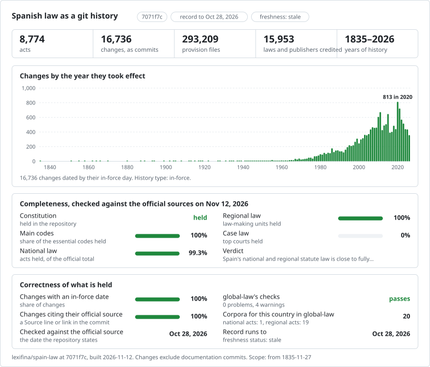

# Spain: law history in git

**English** · **[O léalo en español](README.md)**

<picture>
<source media="(prefers-color-scheme: dark)" srcset="data/effort-dark.svg">

</picture>

The state law of Spain as a git history: one file per block (article, provision, preamble, annex), one commit per amending norm on the day its changes took effect, and that norm as the commit's author. `git blame` names the norm behind every paragraph; `git log` lists every change to an article; picking a date gives the text in force that day.

Part of [lexifina/global-law](https://github.com/lexifina/global-law), one git history for every country's law: this is Spain's national law, which global-law reads at `spain/national/acts/`.

**What is in it now:** the Constitution and 8,773 state norms (ámbito Estatal) from the BOE's consolidated legislation, in force from 1835 to 2026: 859 leyes, 184 leyes orgánicas, 315 reales decretos-leyes, 44 reales decretos legislativos, 3,508 reales decretos, 2,406 órdenes, 253 international agreements and 1,204 resolutions, circulars, decrees, instructions and other norms, in 16,736 commits; and 2,209 later corrections, labelled as such (1,574 repeals and annulments, 626 same-day versions of a block, 9 dates). [`normas.tsv`](normas.tsv) lists every norm with the day the BOE last updated its text; [`data/acts.json`](data/acts.json) gives each norm's status (in force, repealed, annulled, expired) and dates.

Each norm is a folder `estatal/<rank>/<year>/<BOE id>/` with one file per block, named by the BOE's block id (`estatal/real-decreto-legislativo/2015/BOE-A-2015-11430/a48.md` is Article 48 of the Estatuto de los Trabajadores, Real Decreto Legislativo 2/2015); each norm's `README.md` lists its blocks in the BOE's order.

The text is in Spanish, as the BOE's consolidated texts print it, with the BOE's own notes (`> Se modifica por ...`). Translations are not part of this record.

## Questions as git commands

| Question | Command |
| --- | --- |
| Every change to Article 48 of the Estatuto de los Trabajadores | `git log -p --word-diff law-head -- estatal/real-decreto-legislativo/2015/BOE-A-2015-11430/a48.md` |
| Which norm wrote each paragraph of Article 48? | `git blame law-head -- estatal/real-decreto-legislativo/2015/BOE-A-2015-11430/a48.md` |
| Every version of Article 48, with the day each took effect | `python tools/eslaw.py log estatal/real-decreto-legislativo/2015/BOE-A-2015-11430/a48.md` |
| Article 48 as in force on 1 January 2020 | `python tools/eslaw.py on 2020-01-01 estatal/real-decreto-legislativo/2015/BOE-A-2015-11430/a48.md` |

On `main`, `git blame` and `git log -p` name commit 57854db for every line: on 2026-11-05 it restored every file in one commit, after the commit before it had dropped them by mistake. So run them on `law-head`, the last commit of the original build (2026-10-28); `tools/eslaw.py` reads `main`, with every later correction.

**Outside git**, we also host this record publicly, for free:

- **[Ask Claude about Spanish law](https://global-law.lexifina.com/v1/try_claude?country=spain)**: opens Claude with a first question ready.
- **[Ask ChatGPT](https://global-law.lexifina.com/v1/try_chatgpt?country=spain)**: the same question in ChatGPT.
- **[Call the API in your browser](https://global-law.lexifina.com/v1/search_law?query=vacaciones+anuales&jurisdictions=spain)**: a search of Spanish law for "vacaciones anuales" (annual leave), returned as JSON. See the [documentation here](https://lexifina.com/api/global-law).

Both assistants read the record through the free Global law connector (MCP, `https://global-law.lexifina.com/mcp`); the first time, the chat gives you the link that adds it. Ask in Spanish or in English.

**Host it yourself easily.** All it takes is git and Python, and the tools run on your machine:

```sh
git clone --depth 1 https://github.com/lexifina/global-law && cd global-law
python3 tools/countries.py add spain/national/acts
python3 tools/law.py show 2026-01-01 spain/national/acts/estatal/real-decreto-legislativo/2015/BOE-A-2015-11430/a48.md
```

Opened in Claude Code, Cursor, VS Code or Codex, the clone also starts a local MCP server with the same tools ([MCP.md](https://github.com/lexifina/global-law/blob/main/MCP.md)).

## Dates

Each commit is dated at noon, Europe/Madrid, on the day the version took effect (the BOE's `fecha_vigencia` for it), and carries it in its `In-force:` trailer, beside `Published:`, `Enacted:` and `Norma:`:

- a norm's first commit is its first consolidated text in the BOE, on the day it came into force;
- versions the BOE dates after 2026-10-28 (295) or gives no in-force day (1,156) are left out; where a block has two versions on one day, the last in the BOE's order is the text that day, and the earlier ones are kept as labelled corrections ([`data/same-day-versions.json`](data/same-day-versions.json));
- git cannot store dates before 1970, so the 332 earlier commits are dated from 1970-01-01, one second apart, with the real day in `In-force:`. Ask for a date with `tools/eslaw.py`, not `git log --before`.

Each change is credited to the norm the BOE names for it, as `BOE-A-2025-15741 (Real Decreto-ley 9/2025, de 29 de julio)`; rulings of the Tribunal Constitucional that change a text are credited the same way (`BOE-A-2024-25523 (Sentencia 140/2024, de 6 de noviembre)`). The 14 versions with no valid BOE identifier are credited to the publisher, `Agencia Estatal Boletin Oficial del Estado (BOE)`, and the corrections to `Lexifina`, with `Kind: correction`.

## How it is checked

- `build/check_repo.py` compares every block version, byte for byte, with the file at the last commit in force on its day, and the words of each version's XML with its file: 397,165 versions, 0 differ (2026-10-28).
- A second build from the same data gave the same law history (`law-head` 56dbb7491cbd); the original build's facts are in `REPRODUCE.md` at commit `ee54e80`.
- Each later correction is checked against the BOE: kept notices word for word with its XML, unchanged files with the published base, and 30 repeals against the BOE independently (see [`REPRODUCE.md`](REPRODUCE.md)).
- History is append-only: no merge commits, and no published commit is rewritten.

## What it does not show

- **Regional law.** The law of the 17 autonomous communities and of Ceuta and Melilla is in its own repositories (such as [spain-catalonia-law](https://github.com/lexifina/spain-catalonia-law)), which global-law reads under `spain/<community>/acts/`.
- **Norms the BOE does not consolidate**, and any norm's text before its first consolidated version; 47 norms in `data/acts.json` have no text here.
- **Case law**, apart from rulings the BOE records as changing a norm's text.
- **Changes that leave the words alone**: transitional provisions, rulings that interpret without annulling and suspensions change the law without changing these files; whether a change reaches a given case (Código Civil art. 2.3, Constitución art. 9.3) is not decided here.
- **When 418 norms ceased to apply**: the BOE marks them as expired (vigencia agotada) without a day, so their text stays, marked as expired.

## Sources

| Source | Kind | Past versions | Notes |
| --- | --- | --- | --- |
| [Agencia Estatal Boletín Oficial del Estado](https://www.boe.es) | Official gazette: consolidated legislation (legislación consolidada), ámbito Estatal | yes, every version of each block, with its in-force day | Read through its [open-data API](https://www.boe.es/datosabiertos/api/api.php) on 2026-10-28; repeal and lifecycle data checked 2026-11-05 |

## Licence

See [`LICENSE`](LICENSE). Basado en datos de la Agencia Estatal Boletín Oficial del Estado (https://www.boe.es): the texts are the BOE's consolidated texts, reused under its reuse conditions (Resolution of 27 June 2024). They are informative only; only the texts published in the «Boletín Oficial del Estado» are official and authentic. The code and documentation are CC0 1.0.

No AI model wrote or changed legal text, and none runs when the history is built; the builder was written by Claude Code with Claude Opus 5.5, and the code for the later corrections by GPT-6, reviewed by GPT-6 Astra (see [`REPRODUCE.md`](REPRODUCE.md)).

## More

From [lexifina/global-law](https://github.com/lexifina/global-law):

- [FEATURES.md](https://github.com/lexifina/global-law/blob/main/FEATURES.md): every feature, and what every corpus must support (`git blame`, `law.py`, the MCP tools)
- [FAQ.md](https://github.com/lexifina/global-law/blob/main/FAQ.md): questions and answers · [CONTRIBUTING.md](https://github.com/lexifina/global-law/blob/main/CONTRIBUTING.md): proposing changes · [MCP.md](https://github.com/lexifina/global-law/blob/main/MCP.md): the MCP server · [REPRODUCE.md](https://github.com/lexifina/global-law/blob/main/REPRODUCE.md): how it was built · [CHANGELOG.md](https://github.com/lexifina/global-law/blob/main/CHANGELOG.md)
- [FRESHNESS.md](https://github.com/lexifina/global-law/blob/main/FRESHNESS.md): how current each corpus is · [Monitoring](https://github.com/lexifina/global-law/tree/main/monitoring): whether updates are running · [WATCHING.md](https://github.com/lexifina/global-law/blob/main/WATCHING.md): how each official source is watched for changes
- [performance/](https://github.com/lexifina/global-law/tree/main/performance): how fast the tools are, measured
- [visualisations/](https://github.com/lexifina/global-law/tree/main/visualisations): charts and bridges across the world's law
- [Vulnerabilities](https://github.com/lexifina/global-law/tree/main/vulnerabilities): mistakes in legislation as published
