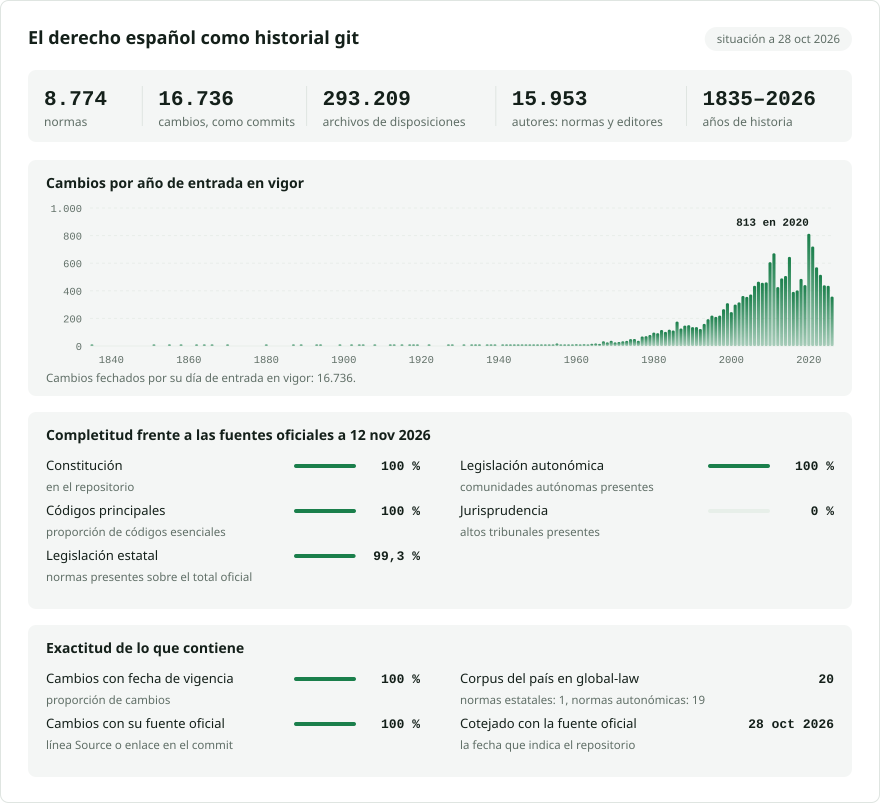

# España: historia del derecho en git

**Español** · **[Or read it in English](README.en.md)**

<picture>
<source media="(prefers-color-scheme: dark)" srcset="data/es/effort-dark.svg">

</picture>

El derecho estatal de España como historial de git: un archivo por bloque (artículo, disposición, preámbulo, anexo), un commit por norma modificadora en el día en que entraron en vigor sus cambios, y esa norma como autora del commit. `git blame` indica la norma que está detrás de cada párrafo; `git log` enumera cada cambio de un artículo; al elegir una fecha se obtiene el texto vigente ese día.

Forma parte de [lexifina/global-law](https://github.com/lexifina/global-law), un único historial de git para el derecho de todos los países: este es el derecho nacional de España, que global-law lee en `spain/national/acts/`.

**Qué contiene ahora:** la Constitución y 8.773 normas de ámbito Estatal de la legislación consolidada del BOE, en vigor desde 1835 hasta 2026: 859 leyes, 184 leyes orgánicas, 315 reales decretos-leyes, 44 reales decretos legislativos, 3.508 reales decretos, 2.406 órdenes, 253 acuerdos internacionales y 1.204 resoluciones, circulares, decretos, instrucciones y otras normas, en 16.736 commits; y 2.209 correcciones posteriores, etiquetadas como tales (1.574 derogaciones y anulaciones, 626 versiones de un bloque del mismo día, 9 fechas). [`normas.tsv`](normas.tsv) enumera todas las normas con el día en que el BOE actualizó su texto por última vez; [`data/acts.json`](data/acts.json) da la situación de cada norma (en vigor, derogada, anulada, vigencia agotada) y sus fechas.

Cada norma es una carpeta `estatal/<rango>/<año>/<identificador del BOE>/` con un archivo por bloque, con el nombre del identificador de bloque del BOE (`estatal/real-decreto-legislativo/2015/BOE-A-2015-11430/a48.md` es el artículo 48 del Estatuto de los Trabajadores, Real Decreto Legislativo 2/2015); el `README.md` de cada norma enumera sus bloques en el orden del BOE.

El texto está en castellano, tal como lo imprimen los textos consolidados del BOE, con las propias notas del BOE (`> Se modifica por ...`). Las traducciones no forman parte de este registro.

## Preguntas como comandos de git

| Pregunta | Comando |
| --- | --- |
| Cada cambio del artículo 48 del Estatuto de los Trabajadores | `git log -p --word-diff origin/law-head -- estatal/real-decreto-legislativo/2015/BOE-A-2015-11430/a48.md` |
| ¿Qué norma redactó cada párrafo del artículo 48? | `git blame origin/law-head -- estatal/real-decreto-legislativo/2015/BOE-A-2015-11430/a48.md` |
| Cada versión del artículo 48, con el día en que entró en vigor | `python tools/eslaw.py log estatal/real-decreto-legislativo/2015/BOE-A-2015-11430/a48.md` |
| El artículo 48 vigente el 1 de enero de 2020 | `python tools/eslaw.py on 2020-01-01 estatal/real-decreto-legislativo/2015/BOE-A-2015-11430/a48.md` |

En `main`, `git blame` y `git log -p` indican el commit 57854db para cada línea: el 2026-11-05 restauró todos los archivos en un solo commit, después de que el commit anterior los hubiera eliminado por error. Por eso se ejecutan sobre `law-head`, el último commit de la construcción original (2026-10-28); `tools/eslaw.py` lee `main`, con todas las correcciones posteriores.

**Fuera de git** también ofrecemos este registro de forma pública y gratuita:

- **[Pregunte a Claude sobre el derecho español](https://global-law.lexifina.com/v1/try_claude?country=spain)**: abre Claude con una primera pregunta preparada.
- **[Pregunte a ChatGPT](https://global-law.lexifina.com/v1/try_chatgpt?country=spain)**: la misma pregunta en ChatGPT.
- **[Busque en el derecho español en nuestro sitio](https://lexifina.com/law?country=spain&q=vacaciones+anuales)**: una búsqueda de «vacaciones anuales», con el texto de cada precepto y sus versiones, sin cuenta.
- **[API REST para desarrolladores](https://global-law.lexifina.com/v1/search_law?query=vacaciones+anuales&jurisdiction=spain)**: la misma búsqueda en JSON, sin clave. La documentación está [aquí](https://lexifina.com/api/global-law).

Ambos asistentes leen el registro a través del conector gratuito Global law (MCP, `https://global-law.lexifina.com/mcp`); la primera vez, el chat le da el enlace para añadirlo. Pregunte en español o en inglés.

**Ejecútelo usted mismo fácilmente.** Basta con git y Python, y las herramientas se ejecutan en su equipo:

```sh
git clone --depth 1 https://github.com/lexifina/global-law && cd global-law
python3 tools/countries.py add spain/national/acts
python3 tools/law.py show 2026-01-01 spain/national/acts/estatal/real-decreto-legislativo/2015/BOE-A-2015-11430/a48.md
```

Abierto en Claude Code, Cursor, VS Code o Codex, el clon inicia también un servidor MCP local con las mismas herramientas ([MCP.md](https://github.com/lexifina/global-law/blob/main/MCP.md)).

## Fechas

Cada commit lleva la fecha a mediodía, hora de Madrid (Europe/Madrid), del día en que la versión entró en vigor (la `fecha_vigencia` que le da el BOE), y la incluye en su trailer `In-force:`, junto a `Published:`, `Enacted:` y `Norma:`:

- el primer commit de una norma es su primer texto consolidado en el BOE, en el día en que entró en vigor;
- quedan fuera las versiones a las que el BOE da una fecha posterior al 2026-10-28 (295) o ninguna fecha de entrada en vigor (1.156); cuando un bloque tiene dos versiones el mismo día, la última en el orden del BOE es el texto de ese día, y las anteriores se conservan como correcciones etiquetadas ([`data/same-day-versions.json`](data/same-day-versions.json));
- git no puede almacenar fechas anteriores a 1970, por lo que los 332 commits anteriores llevan fechas a partir del 1970-01-01, con un segundo de diferencia, y el día real en `In-force:`. Para consultar una fecha, use `tools/eslaw.py`, no `git log --before`.

Cada cambio se atribuye a la norma que el BOE indica para él, como `BOE-A-2025-15741 (Real Decreto-ley 9/2025, de 29 de julio)`; las sentencias del Tribunal Constitucional que cambian un texto se atribuyen del mismo modo (`BOE-A-2024-25523 (Sentencia 140/2024, de 6 de noviembre)`). Las 14 versiones sin un identificador válido del BOE se atribuyen al editor, `Agencia Estatal Boletin Oficial del Estado (BOE)`, y las correcciones a `Lexifina`, con `Kind: correction`.

## Cómo se comprueba

- `build/check_repo.py` compara cada versión de bloque, byte a byte, con el archivo del último commit vigente en su día, y las palabras del XML de cada versión con su archivo: 397.165 versiones, 0 diferencias (2026-10-28).
- Una segunda construcción a partir de los mismos datos dio el mismo historial de derecho (`law-head` 56dbb7491cbd); los datos de la construcción original están en `REPRODUCE.md` en el commit `ee54e80`.
- Cada corrección posterior se comprueba frente al BOE: los avisos conservados, palabra por palabra con su XML; los archivos sin cambios, con la base publicada; y 30 derogaciones, frente al BOE de forma independiente (véase [`REPRODUCE.md`](REPRODUCE.md)).
- El historial solo se amplía: no hay commits de fusión y ningún commit publicado se reescribe.
- [vulnerabilities/](vulnerabilities/): posibles errores de técnica normativa en el derecho español, hallados por los detectores de global-law y comprobados a mano.

## Lo que no muestra

- **El derecho autonómico.** El derecho de las 17 comunidades autónomas y de Ceuta y Melilla está en sus propios repositorios (como [spain-catalonia-law](https://github.com/lexifina/spain-catalonia-law)), que global-law lee en `spain/<comunidad>/acts/`.
- **Las normas que el BOE no consolida**, ni el texto de una norma anterior a su primera versión consolidada; 47 normas de `data/acts.json` no tienen texto aquí.
- **La jurisprudencia**, salvo las sentencias que el BOE registra como cambios del texto de una norma.
- **Los cambios que no tocan las palabras**: las disposiciones transitorias, las sentencias que interpretan sin anular y las suspensiones cambian el derecho sin cambiar estos archivos; aquí no se decide si un cambio alcanza a un caso concreto (Código Civil art. 2.3, Constitución art. 9.3).
- **Cuándo dejaron de aplicarse 418 normas**: el BOE las marca como de vigencia agotada sin indicar el día, así que su texto se mantiene, marcado como de vigencia agotada.

## Fuentes

| Fuente | Tipo | Versiones anteriores | Notas |
| --- | --- | --- | --- |
| [Agencia Estatal Boletín Oficial del Estado](https://www.boe.es) | Diario oficial: legislación consolidada, ámbito Estatal | sí, cada versión de cada bloque, con su día de entrada en vigor | Leída a través de su [API de datos abiertos](https://www.boe.es/datosabiertos/api/api.php) el 2026-10-28; datos de derogación y vigencia comprobados el 2026-11-05 |

## Licencia

Véase [`LICENSE`](LICENSE). Basado en datos de la Agencia Estatal Boletín Oficial del Estado (https://www.boe.es): los textos son los textos consolidados del BOE, reutilizados conforme a sus condiciones de reutilización (Resolución de 27 de junio de 2024). Son de carácter meramente informativo; únicamente tienen la consideración de oficiales y auténticos los textos publicados en el «Boletín Oficial del Estado». El código y la documentación son CC0 1.0.

Ningún modelo de IA ha redactado ni modificado texto jurídico, y ninguno se ejecuta al construir el historial; el constructor lo escribió Claude Code con Claude Opus 5.5, y el código de las correcciones posteriores GPT-6, revisado por GPT-6 Astra (véase [`REPRODUCE.md`](REPRODUCE.md)).

Esta es una traducción de la versión inglesa ([README.en.md](README.en.md)); si difieren, prevalece la versión inglesa.

## Visualizaciones

[visualisations/](visualisations/): el derecho español en 20 gráficos, a partir de los datos de este repositorio.

Entre ellos:

- Las normas en vigor y su edad, los acuerdos internacionales y las normas más modificadas
- Los reales decretos-leyes y su convalidación, las leyes ómnibus y las leyes de presupuestos
- El calendario del BOE, la Constitución, los códigos Civil y Penal y los tribunales

## Más información

Del repositorio [lexifina/global-law](https://github.com/lexifina/global-law) (páginas en inglés):

- [FEATURES.md](https://github.com/lexifina/global-law/blob/main/FEATURES.md): todas las funciones y lo que cada corpus debe admitir (`git blame`, `law.py`, herramientas MCP)
- [FAQ.md](https://github.com/lexifina/global-law/blob/main/FAQ.md): preguntas y respuestas · [CONTRIBUTING.md](https://github.com/lexifina/global-law/blob/main/CONTRIBUTING.md): proponer cambios · [MCP.md](https://github.com/lexifina/global-law/blob/main/MCP.md): servidor MCP · [REPRODUCE.md](https://github.com/lexifina/global-law/blob/main/REPRODUCE.md): cómo se ha construido · [CHANGELOG.md](https://github.com/lexifina/global-law/blob/main/CHANGELOG.md)
- [FRESHNESS.md](https://github.com/lexifina/global-law/blob/main/FRESHNESS.md): lo actualizado que está cada corpus · [Supervisión](https://github.com/lexifina/global-law/tree/main/monitoring): si las actualizaciones funcionan · [WATCHING.md](https://github.com/lexifina/global-law/blob/main/WATCHING.md): cómo se vigila cada fuente oficial para detectar cambios
- [performance/](https://github.com/lexifina/global-law/tree/main/performance): la rapidez de las herramientas, medida
- [visualisations/](https://github.com/lexifina/global-law/tree/main/visualisations): gráficos y conexiones a través del derecho de todo el mundo
- [Vulnerabilidades](https://github.com/lexifina/global-law/tree/main/vulnerabilities): errores en las normas tal como se publicaron
