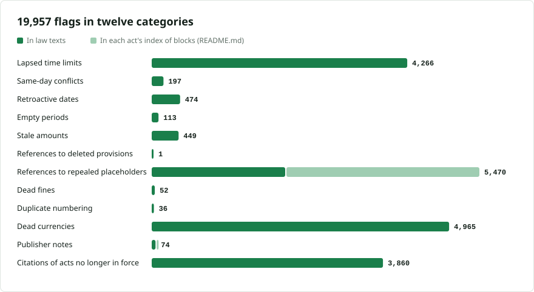

# Vulnerabilities in Spanish law

[Español](README.md) · **English**

<picture>
<source media="(prefers-color-scheme: dark)" srcset="img/flags-by-category-dark.svg">

</picture>

The vulnerability detectors from [lexifina/global-law](https://github.com/lexifina/global-law/tree/main/vulnerabilities) look for mechanical mistakes in legislation: a rule applying "until" a date that has passed, a time limit extended only after it had run out, an amount changed in one place but not in another, a penalty for breaching an article that has been repealed, a provision citing an act that is no longer in force. global-law's published list (9 November 2026) covered Spain with 15,868 flags from an earlier copy of this repository, among them 158 on the organic-law reserve and 8 on a missing enabling power, which rest on citations a model extracts and were not run here. This is a run over this repository only, as it stood at commit [`62bb9b2`](https://github.com/lexifina/spain-law/commit/62bb9b2dea22b5c1164278f3a4e883b79df02db7) on 15 November 2026, with global-law's Spain-only detector of citations of acts that BOE lists as no longer in force.

**In short:** the detectors raised 19,957 flags. A language model reviewed 249 of the strongest, arguing each one for and against; 71 survived. Checked by hand in this repository, five of them, in three provisions, look like real mistakes in Spanish law: time limits extended only after they had run out, with no retroactive wording. The 21% withholding rate in Additional Provision 14 of the Corporate Income Tax Act (Royal Legislative Decree 4/2004) ran "until 31 December 2013"; Royal Decree-law 1/2014 extended it to 2014 only from 26 January 2014, and its preamble says the change "should have been made through the State Budget Act for 2014". Standard-definition television channels could keep broadcasting "until 1 January 2023" (Transitional Provisions 4 and 5 of Royal Decree 391/2019); Royal Decree 16/2023 moved the date to 14 February 2024 only from 19 January 2023 (2 flags). The exception allowing brucellosis vaccination (Transitional Provision 4 of Royal Decree 2611/1996) lapsed twice: from 1 January to 16 June 2011 (Royal Decree 727/2011) and throughout 2015 (Royal Decree 71/2016 applies from 1 January 2016), although the 2008 extension had been made retroactive (2 flags). Five more are real gaps, but chosen rather than overlooked: the Congress of Deputies declined to validate Royal Decree-laws 9/2024 and 16/2025, and until the Government re-enacted their measures the suspension of evictions, the compensation claims of landlords and the screening of foreign investment rested on dates that had passed. Of the other 61, 21 come from how this repository's record compares and dates texts, 31 are lawful, 7 are citations of repealed acts that a substitution clause cures or that are harmless, and 2 are spent. The model does not review four categories; reading them turned up one more likely mistake: among the cases in which failing to self-assess the Canary Islands general indirect tax is an offence, Article 63(5) of Law 20/1991 still names those "under paragraph 6 of Article 58 ter", an article Law 31/2022 left without content from 1 January 2023, when it moved the special regimes to a law of the Canary Islands, without touching Article 63. Later, this will be formalised in Lean, similar to our work on [the US tax code](https://lexifina.com/blog/formalizing-the-us-tax-code) and [US case law](https://lexifina.com/blog/formalizing-all-us-case-law-in-lean).

A flag is a prompt to look, not legal advice, and nothing here has been tested in court.

## Flags by category

| Category | What it looks for | Flags | In law texts | Reviewed | Survived review |
| --- | --- | ---: | ---: | ---: | ---: |
| Lapsed time limits | Text still applying a rule "until" a date that has passed | 4,266 | 4,266 | 41 | 3 |
| Same-day conflicts | Two acts changing the same provision on the same day | 197 | 197 | 40 | 4 |
| Retroactive or pre-publication dates | A rule in force before it was made or published | 474 | 474 | 40 | 4 |
| Empty periods | A time limit extended by an act that took effect after it had run out | 113 | 113 | 51 | 33 |
| Stale amounts | An amount changed in one place but still standing elsewhere | 449 | 449 | 42 | 20 |
| References to deleted provisions | A provision citing an article that no longer exists | 1 | 1 | 1 | 0 |
| References to repealed placeholders | A provision citing an article that now reads only "(Derogado)", "(Suprimido)" or "(Sin contenido)" | 5,470 | 2,229 | 0 | 0 |
| Dead fines | A penalty for breaching an article that has been repealed | 52 | 52 | 0 | 0 |
| Duplicate numbering | Two units with the same number in one act | 36 | 36 | 0 | 0 |
| Dead currencies | Amounts in currencies no longer in use | 4,965 | 4,965 | 0 | 0 |
| Publisher notes | BOE's own "[sic]" and similar notes | 74 | 64 | 0 | 0 |
| Citations of acts no longer in force | A law in force citing an act that BOE lists as no longer in force | 3,860 | 3,860 | 34 | 7 |

"In law texts" counts every file of a norm under `estatal/`: the Constitution, laws and organic laws, royal decree-laws and royal legislative decrees, royal decrees, orders, resolutions, circulars, instructions and international agreements. The other flags are in each norm's `README.md`, which lists its blocks as links (the reference detectors read a link to a repealed article as a citation of it) and repeats the headings BOE marks "[sic]". The search for lapsed time limits now also reads "hasta el día 31 de diciembre de 2020" and "31 de diciembre del (año) 2020": 4,006 flags became 4,266, and the empty-period detector, which reads the same dates, found 113 where it had found 112. It still leaves out 158 phrases, past and future, that give only a year or its end ("hasta el año 2020", "hasta finales de 2020"). The search for dead currencies no longer takes "Marco" (framework) or "Escudo" (coat of arms) at the start of a heading or a list item for a currency (5,214 flags became 4,965). A repealed article keeps its file here, reading only "(Derogado)", "(Suprimido)" or "(Sin contenido)", so a reference to it counts as a reference to a repealed placeholder, not to a deleted provision, and the search for repeal gaps found nothing. Citations of acts no longer in force is global-law's Spain-only detector; it reads BOE's `vigencia_agotada` from this repository's [`normas.tsv`](../normas.tsv), and global-law's own review of it was followed by the same second, arguing-against pass as the other categories.

*Edge cases: the 71 flags that survived the review, grouped by what they turned out to be, and what the other flags are, in [EDGE-CASES.en.md](EDGE-CASES.en.md).*

## Problems found in this repository

- **Articles repealed as a range keep their old text:** where BOE replaces the articles of a repealed part with one block ("Artículos 21 a 40. (Derogados)"), each article's own file stays as it last read, and the norm's `README.md` lists both. At least 2,677 article files in 56 norms read this way, among them Articles 573 to 869 of the [Código de Comercio](https://github.com/lexifina/spain-law/blob/62bb9b2dea22b5c1164278f3a4e883b79df02db7/estatal/real-decreto/1885/BOE-A-1885-6627/a580.md), repealed by Law 14/2014 from 25 September 2014 ([the change](https://github.com/lexifina/spain-law/commit/ea5707b0621ff8a556dd0d12f965f01bd1e647b6)); Articles 629 to 632 of the [Código Penal](https://github.com/lexifina/spain-law/blob/62bb9b2dea22b5c1164278f3a4e883b79df02db7/estatal/ley-organica/1995/BOE-A-1995-25444/a632.md), repealed by Organic Law 1/2015 from 1 July 2015; and Articles 21 to 40 of [Organic Law 3/2013](https://github.com/lexifina/spain-law/blob/62bb9b2dea22b5c1164278f3a4e883b79df02db7/estatal/ley-organica/2013/BOE-A-2013-6732/a22.md) on doping, repealed by Organic Law 11/2021 from 30 December 2021. A reader of the file, or of the text on a date, sees these articles as in force (126 flags are in such files).
- **Restatements credited to the repository:** the 75 commits that restore the text in force after BOE's same-day versions are authored by Lexifina and name the law only in their message and `Re-asserts:` trailer, so `git blame` and tools that read the author as the act that made a change credit those lines to Lexifina. Read that way, every one of the 197 same-day conflicts had Lexifina as a second "act"; this run credits each restatement to the act of the commit it restates.

## Files

| File | What it holds |
| --- | --- |
| [data/flags.csv](data/flags.csv) | Every flag, one row per provision and issue |
| [data/reviewed.csv](data/reviewed.csv) | The 249 flags the model reviewed, with its verdict and reason |
| [data/by_category.csv](data/by_category.csv) | The counts in the table above |
| [tools/](tools/) | The scripts that made this run |

Columns: `category` and `category_es` (the category in English and Spanish), `detector`, `kind` (`law` or `other`), `path` (the file in this repository; empty for a retroactive date, which names the act), `date` (the date the flag turns on), `reference` (the act or line involved), `summary`, `score` (the detector's ranking, 0 to 1), `review` (`artefact`, `lawful` or `candidate_defect`), `survives_rebuttal`, `review_note` (the model's reason, in English), `url` (the provision at the commit that was read, or, for a retroactive date, the commit that made the act's version on that day).

## How it was made

- **Detectors:** global-law's [vulnerabilities/scripts](https://github.com/lexifina/global-law/tree/main/vulnerabilities/scripts), run on this repository at commit `62bb9b2`. global-law replays this repository only up to an earlier commit, so the history table the detectors read was built from this repository's own commits (the act that made each change, its `In-force` date and its `Kind`; corrections and documentation are left out, and a restatement is credited to the act of the commit it restates). The detectors carry the fixes global-law's scripts received in the runs on other country repositories, and two for Spanish: the date forms and currency words above. Citations of acts no longer in force were found by global-law's `es_crossref.py`.
- **Model review:** gpt-5.4-mini, the 40 strongest flags per category, and for lapsed time limits also the 40 strongest in law texts; one pass says whether a flag is real, a second argues that it is not. Empty periods use global-law's own review for that category, on the 51 flags whose old and new date are in one sentence, and citations of acts no longer in force use global-law's own review on the 40 strongest (33 after it set aside citations of a different act with the same number), each followed by the same second pass. Same-day conflicts were reviewed again after restatements were credited to their acts. The model does not review references to repealed placeholders, dead fines, duplicate numbering, dead currencies or publisher notes. global-law's own list used a different model.
- **Hand check:** every flag that survived was read in this repository's history and texts, and in the extending or citing act where this repository holds it. For the empty periods, the commencement provisions of Royal Decrees 16/2023, 727/2011, 71/2016 and 408/2024 and of Order ITC/2452/2011 were read in the BOE, which this repository does not hold. All 52 dead fines were read, as were a sample of 25 references to repealed placeholders and the dead currencies, duplicate numbers and publisher notes by the words matched.

To report a correction, open an issue with the provision and an official source.

## Licence

The lists and notes are Lexifina's, dedicated to the public domain under CC0 1.0, like the rest of this repository's own code and documentation. Quoted law text is the BOE's consolidated text, reused under the BOE's reuse conditions, "Basado en datos de la Agencia Estatal Boletín Oficial del Estado" (https://www.boe.es); it is for information only, and only the text published in the «Boletín Oficial del Estado» is official and authentic. See [LICENSE](../LICENSE).
